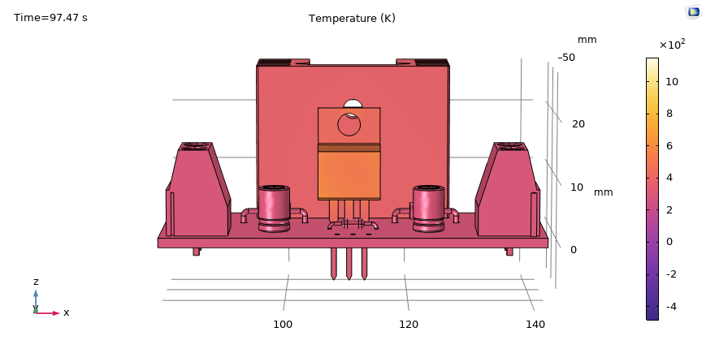
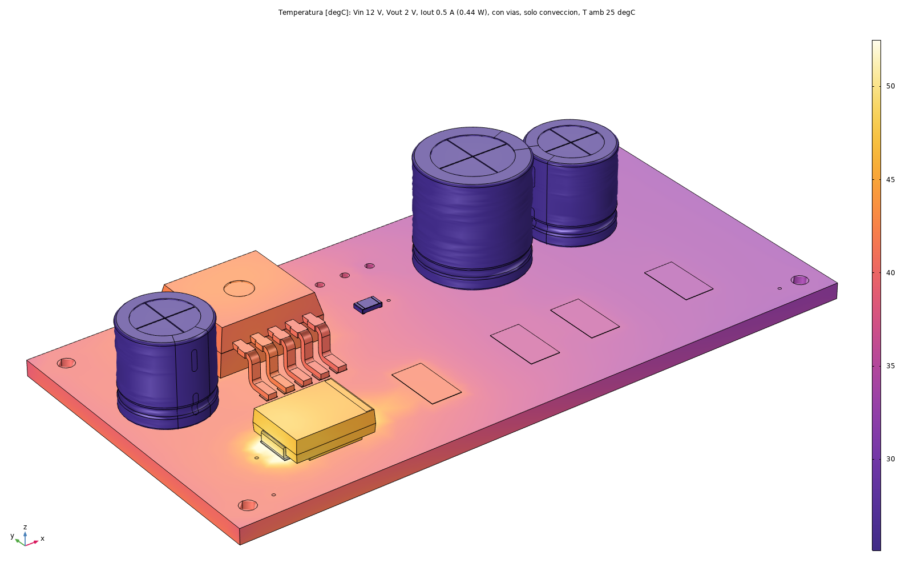
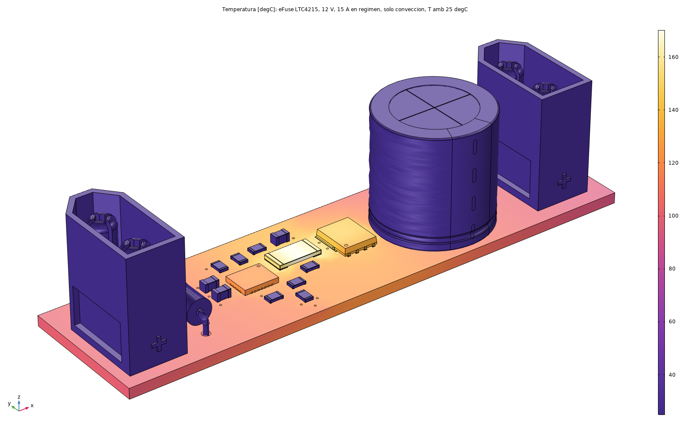
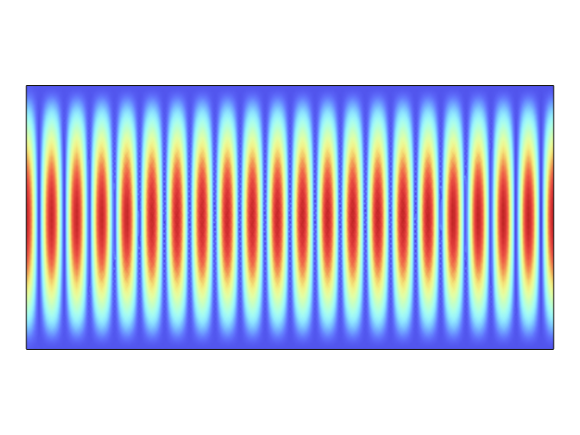
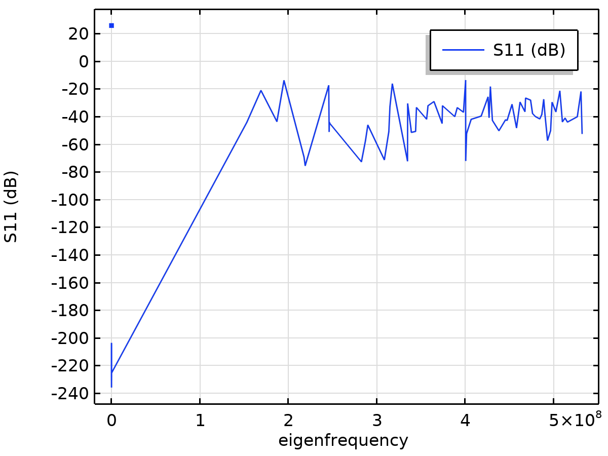
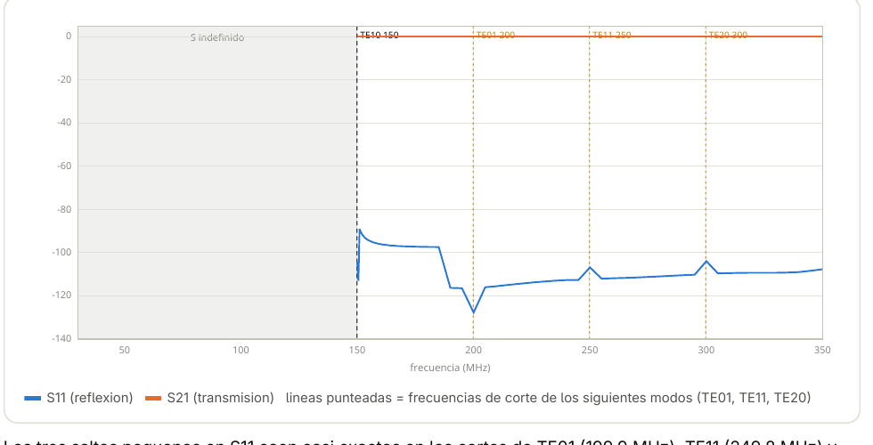
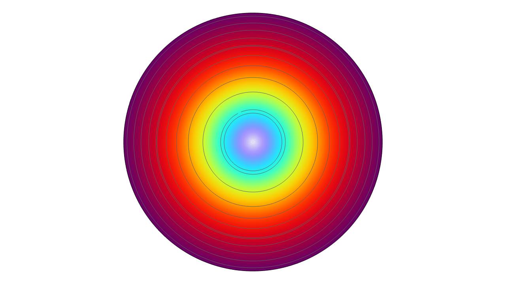
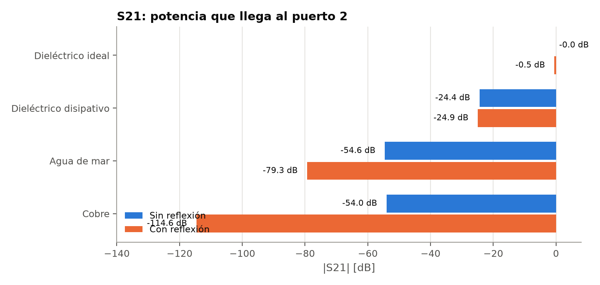

# COMSOL Simulations

COMSOL Multiphysics work pulled out into one place — thermal FEM studies from the power-electronics projects, and RF/electromagnetics coursework. No `.mph` model files here (they're large binaries; the editable models live in each source project or the original coursework folder) — just the figures, methodology, and findings, documented per project.

## Thermal FEM

Coupled electrical/thermal studies of real PCB layouts from the power-electronics projects.

| | Project | What COMSOL found |
|---|---|---|
|  | [`thermal-fem/lm317-power-supply/`](thermal-fem/lm317-power-supply/) | T_J ≈ 143.8°C at worst-case load — the LM317's copper tab (not the epoxy body) was the dominant previously-unmodeled effect |
|  | [`thermal-fem/lm2596-buck-converter/`](thermal-fem/lm2596-buck-converter/) | The catch diode, not the regulator IC, is the real thermal limit at the low-output-voltage extreme |
|  | [`thermal-fem/efuse-ltc4215-hotswap/`](thermal-fem/efuse-ltc4215-hotswap/) | Coupled electrical-thermal model: the copper pours themselves, not the MOSFET or sense resistor, are the dominant heat source at 15A |

Each one found the actual thermal bottleneck somewhere other than where the "obvious" component would suggest. Source repos: [LM317-Adjustable-PowerSupply](https://github.com/IKGB105/LM317-Adjustable-PowerSupply), [LM2596-Adjustable-Buck-Converter](https://github.com/IKGB105/LM2596-Adjustable-Buck-Converter), [EFUSE-LTC4215-HotSwap](https://github.com/IKGB105/EFUSE-LTC4215-HotSwap).

## Electromagnetics / RF

COMSOL RF Module coursework — plane waves, resonant cavities, waveguide ports, eddy currents, and wave propagation/reflection through different media.

| | Topic | What it covers |
|---|---|---|
|  | [`electromagnetics/01-plane-wave-material-sweep/`](electromagnetics/01-plane-wave-material-sweep/) | 2D plane wave at 1 GHz swept across 27 combinations of εr, μr, σ |
|  | [`electromagnetics/02-resonant-cavity-modes/`](electromagnetics/02-resonant-cavity-modes/) | PEC cavity eigenmodes, validated to 0.005% average error against theory across 19 modes |
|  | [`electromagnetics/03-rectangular-waveguide-two-port/`](electromagnetics/03-rectangular-waveguide-two-port/) | TE10 waveguide S-parameters, including why they're undefined below cutoff |
|  | [`electromagnetics/04-skin-effect-copper-coil/`](electromagnetics/04-skin-effect-copper-coil/) | Current density in a copper coil, from spread-out to the classic skin-effect ring |
|  | [`electromagnetics/05-waves-in-media-reflection/`](electromagnetics/05-waves-in-media-reflection/) | Propagation and reflection through vacuum, dielectrics, seawater, and copper, plus total reflection off a perfect conductor |

See [`electromagnetics/README.md`](electromagnetics/README.md) for the full index.

## Why these read as one portfolio

Same "honest logbook" standard throughout: every number is calculated, simulated, or explicitly marked as pending — nothing invented. The thermal studies are coupled physics on real PCB geometry; the electromagnetics studies are COMSOL RF coursework validated against closed-form theory. Different physics, same habit of cross-checking the solver against something independent before trusting the result.
