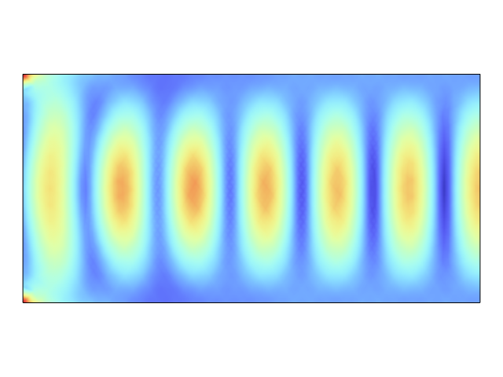
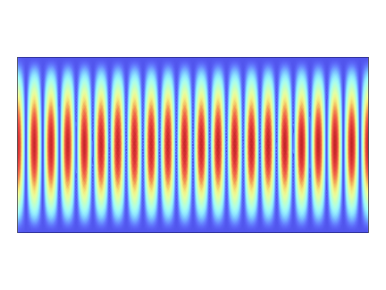

# Plane Wave, 2D, 1 GHz — Material Sweep

A 2D plane wave at 1 GHz propagating through a homogeneous box, swept across every combination of relative permittivity (εr ∈ {1, 4, 10}), relative permeability (μr ∈ {1, 1.5, 2}), and conductivity (σ ∈ {0, 1e-3, 1e-1} S/m) — 27 cases total, each producing an E-field plot and a derived "exponential/box" view.

  
  
  

*Left to right: vacuum baseline (εr=1), a lossless high-permittivity dielectric (εr=10) — visibly shorter wavelength from λ = λ₀/√(εrμr) — and a lossy case (εr=10, μr=1.5, σ=0.1 S/m) showing the field attenuating with depth instead of propagating cleanly.*

## Setup

- Software: COMSOL Multiphysics, *Electromagnetic Waves, Frequency Domain*, 2D.
- Frequency: fixed at 1 GHz.
- Automated with a Python script over the COMSOL Java API ([MPh](https://mph.readthedocs.io/)): `barrido_materiales_mph.py` runs the full 3×3×3 parameter grid against the base model and exports each case's field plot and a secondary "box" plot; `Cuadrados.py` handles the box-region variant.

## What it shows

The qualitative behavior matches theory across the full grid: increasing εr or μr shortens the in-medium wavelength (λ = λ₀/√(εrμr)), while introducing conductivity σ > 0 turns the medium lossy — the field stops being a clean standing/traveling wave and instead shows visible exponential decay with depth, more pronounced as σ increases. This sweep is the groundwork exercise behind the later, more targeted studies in this folder (resonant cavities, waveguide ports, wave propagation through real media like seawater and copper) — same physics, applied here as a systematic parameter sweep rather than a specific named medium.
