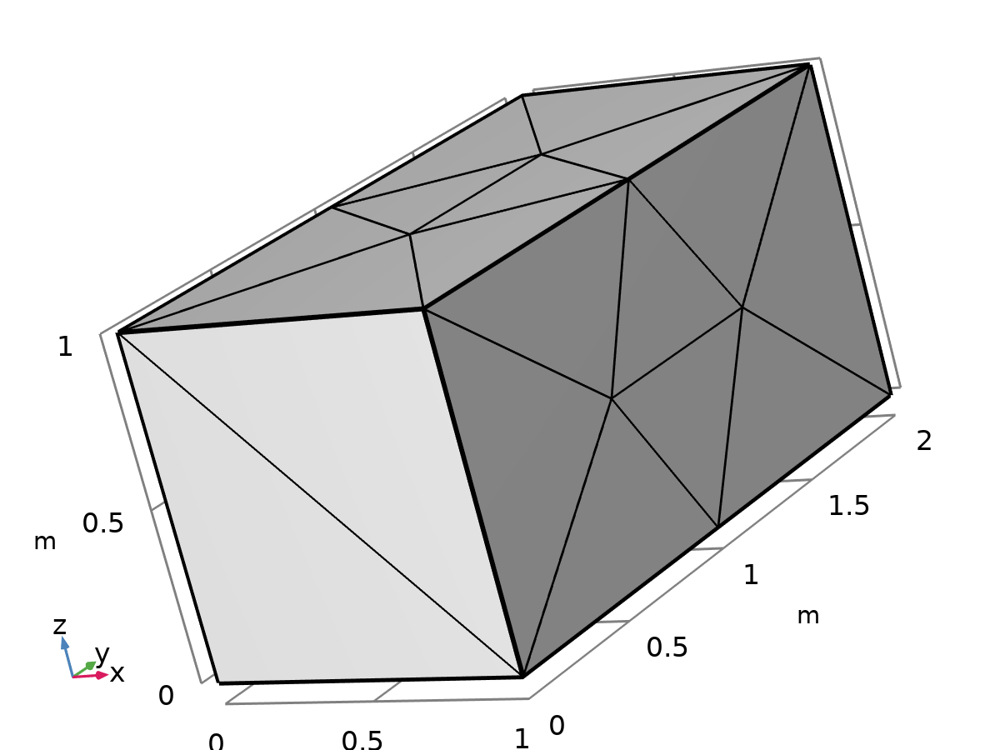
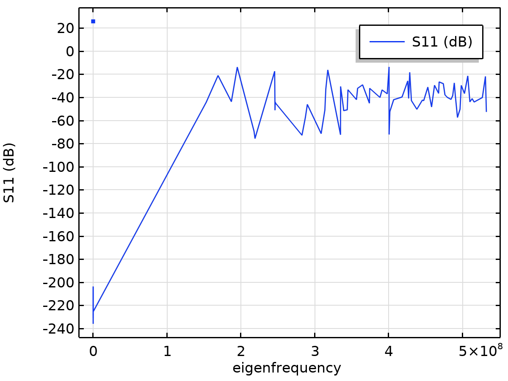

# Rectangular Resonant Cavity — Eigenmode Validation

A rectangular PEC (perfect-electric-conductor) cavity, solved for its eigenfrequencies in COMSOL and cross-checked against the closed-form TE/TM mode formula for a rectangular box.

  
  

*Left: the meshed cavity geometry (a=1.0 m, b=0.75 m, d=0.5 m). Right: S11 against eigenfrequency — each sharp dip is a resonant mode.*

## Setup

- Software: COMSOL Multiphysics, *Electromagnetic Waves, Frequency Domain* eigenfrequency study, 3D.
- Geometry: rectangular box, PEC walls, dimensions a=1.0 m × b=0.75 m × d=0.5 m.
- Validation: `modos_teoricos.py` computes the full theoretical mode set from the standard formula (Pozar, *Microwave Engineering*):

  f_mnl = c / (2·√(εr·μr)) · √((m/a)² + (n/b)² + (l/d)²)

  with TE_mnl requiring m,n ≥ 0 (not both zero) and l ≥ 1, and TM_mnl requiring m,n ≥ 1 and l ≥ 0. `barrido_cavidad_mph.py` pulls COMSOL's solved eigenfrequencies and matches each one against its theoretical counterpart.

## What it found

**19 modes compared, average relative error 0.0049%, maximum relative error 0.0117%** between COMSOL's eigenfrequency solver and the analytical formula — essentially exact agreement, confirming the mesh and solver settings are resolving the cavity modes correctly rather than just "close enough." A second verification case (`verificacion_30/`) repeats the check against an independent `verificacion_cavidad.pdf`.

A companion sweep (`resultados_barridos/eje_z/detalle_eje_z.csv`) varies the cavity's z-dimension (d) to show how each mode's resonant frequency shifts as the box is stretched — the same validated formula, swept instead of fixed.

| | |
|---|---|
| Modes compared | 19 |
| Average relative error | 0.0049% |
| Maximum relative error | 0.0117% |
