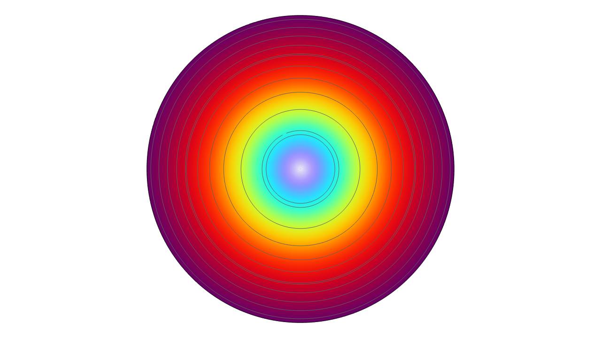
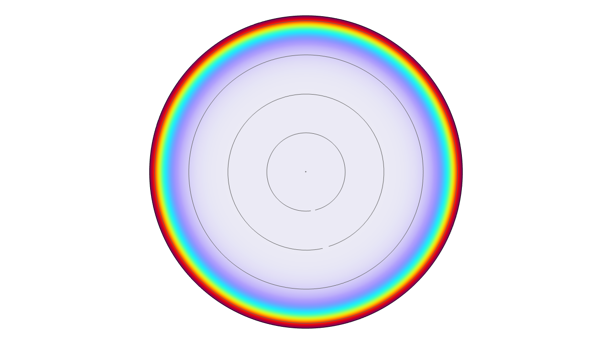
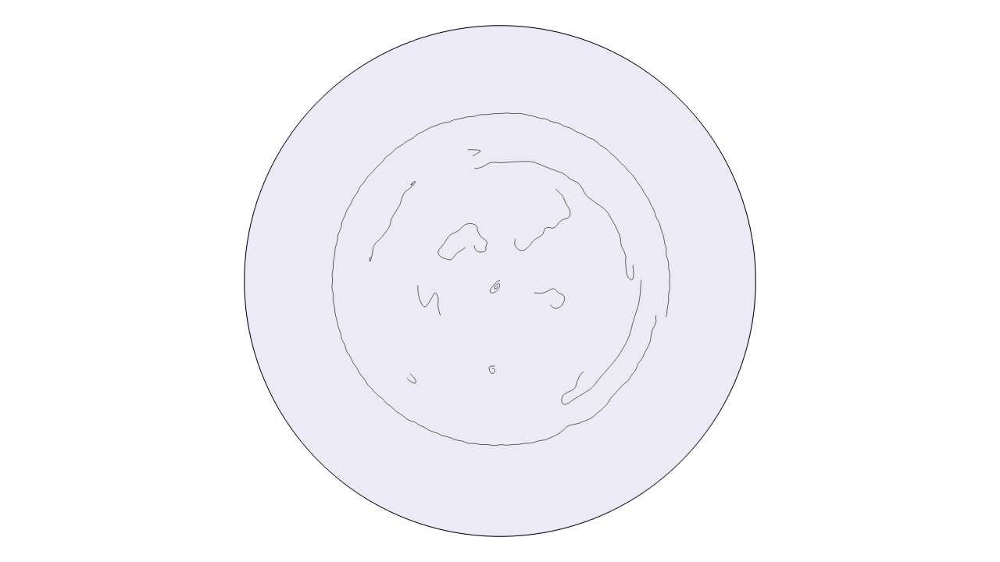

# Skin Effect in a Copper Coil

AC current/field distribution across the cross-section of a multi-turn copper coil, swept across frequency to show the transition from a low-frequency, roughly uniform distribution to the classic high-frequency skin effect — current crowding into a thin ring at the conductor's surface.

  
  
  

*Left: lower-frequency case — the field penetrates well into the conductor interior. Middle: higher-frequency case — the field is confined to a thin ring at the outer boundary, the textbook skin-effect signature, with the interior essentially field-free. Right: the underlying geometry — the coil's individual turns in cross-section.*

## Setup

- Software: COMSOL Multiphysics, *Magnetic Fields* physics (AC/DC Module-style eddy-current formulation), 2D cross-section of a wound copper coil.
- Swept across a range of excitation frequencies to visualize the skin-depth transition.

## What it shows

The two field plots make the skin effect visually unambiguous: at the lower end of the frequency sweep the field profile is smooth and fills the conductor, while at the higher end it collapses into a thin high-intensity ring hugging the surface — current literally being pushed out of the conductor's interior as frequency rises, the same effect that makes high-frequency PCB traces and conductors act thinner than their physical cross-section suggests. (This folder captures the field plots from the sweep; the exact frequency and skin-depth values for each case live in the original model, not reproduced here to avoid stating numbers pulled from the image alone.)
