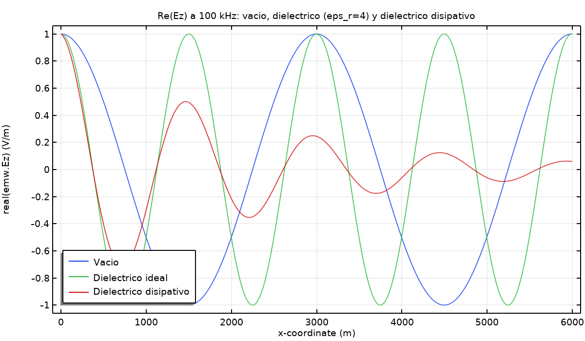
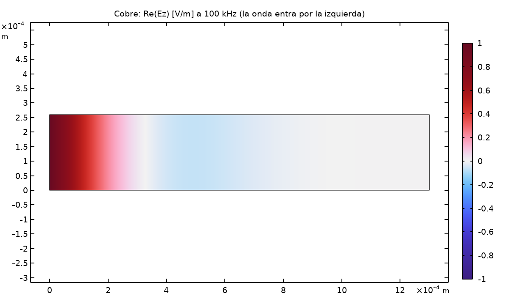

# Propagation Through 5 Media (No Reflection)

The same wave launched into five different homogeneous media — vacuum, an ideal (lossless) dielectric, a lossy dielectric, seawater, and copper — with no reflecting boundary, to isolate how wavelength, phase velocity, and attenuation change with the medium alone.

  
  

*Left: vacuum vs. dielectric comparison. Right: copper — the field is essentially gone within a fraction of a millimeter.*

## Results

| Medium | εr | σ [S/m] | λ [m] | v/c | α [Np/m] |
|---|---|---|---|---|---|
| Vacuum | 1 | 0 | 2997.9 | 1 | 0 |
| Ideal dielectric | 4 | 0 | 1499 | 0.5 | 0 |
| Lossy dielectric | 4 | 5e-6 | 1489.7 | 0.4969 | 0.000468 |
| Seawater | 81 | 4 | 4.9997 | 0.001668 | 1.257 |
| Copper | 1 | 5.8e7 | 0.0013131 (1.31 mm) | 4.38e-7 | 4785 |

(All at 1 GHz; theoretical and COMSOL values matched to within the field-error tolerance logged per case — see [`resultados.csv`](resultados.csv) for the full table including impedance, S21, and per-case error.)

## What it shows

The range is extreme: wavelength drops from ~3 km in vacuum down to **1.3 mm in copper** — six orders of magnitude — while phase velocity collapses from c down to **131 m/s**, slower than sound in air. Copper is such a good conductor at 1 GHz that the "wave" barely propagates at all; it's dominated by the attenuation term (α ≈ 4785 Np/m), consistent with a good-conductor medium where the skin depth is the relevant length scale, not the free-space wavelength. Seawater sits in between — a recognizable "lossy, poorly-propagating" medium, but nowhere near as extreme as copper.
