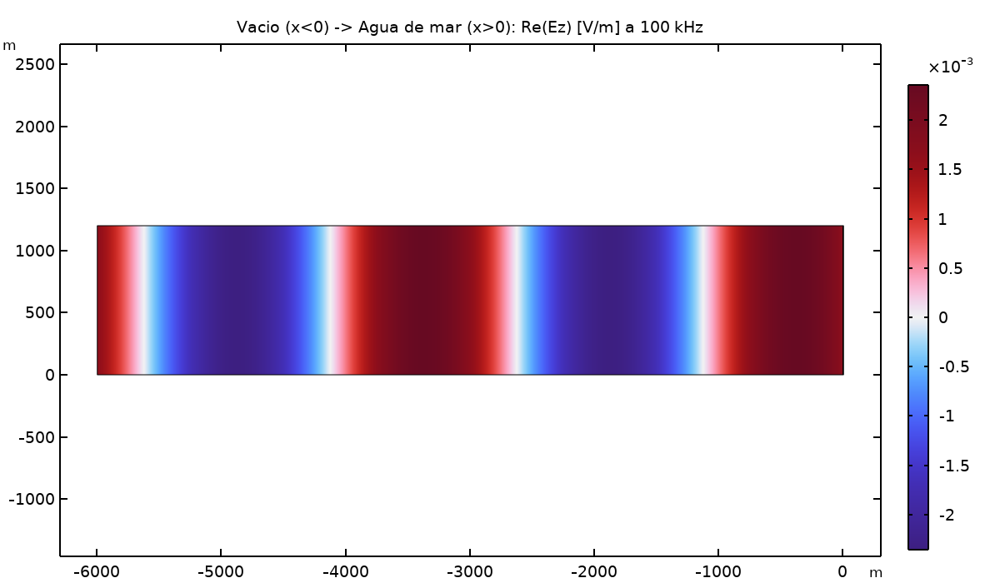
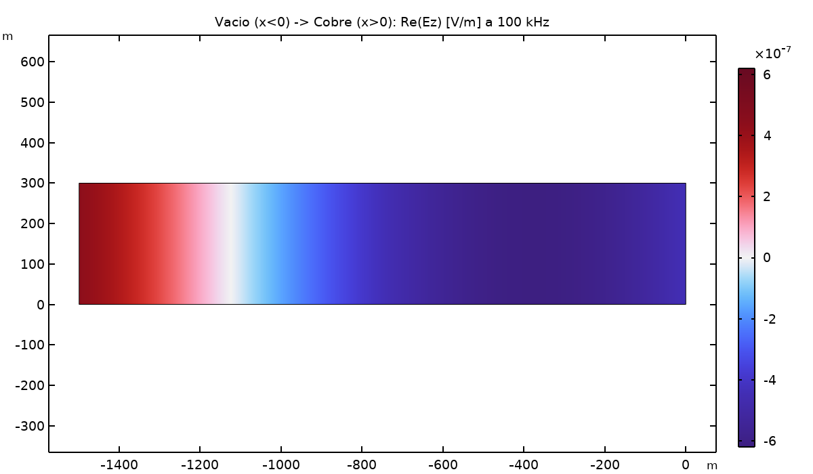

# Reflection: Vacuum → Medium

A wave incident from vacuum onto each of the four non-vacuum media from the companion [`01-propagation-5-media/`](../01-propagation-5-media/) study, measuring the reflection coefficient Γ, transmission τ, and standing-wave ratio (ROE) at the vacuum/medium boundary.

  
  

*Left: vacuum→seawater — strongly reflective, most of the incident power bounces back. Right: vacuum→copper — essentially a perfect mirror.*

## Results

| Medium | \|Γ\| | R = \|Γ\|² | T = 1−R | ROE |
|---|---|---|---|---|
| Ideal dielectric | 0.3333 | 0.1111 | 0.889 | 2 |
| Lossy dielectric | 0.3432 | 0.1178 | 0.882 | 2.045 |
| Seawater | 0.9983 | 0.9967 | 0.00333 | 1199 |
| Copper | 1.0000 | 1.0000 | 8.76e-7 | 4.566e6 |

(Theoretical and COMSOL values agreed to within ~1e-6 relative error across the board — see [`resultados.csv`](resultados.csv) for the full table.)

## What it shows

The two dielectric cases reflect only a modest fraction of the incident power (11–12%) — a mild impedance mismatch. Seawater reflects **99.67%** of the power, and copper reflects effectively **100%** (transmission on the order of 1 part in a million) — both high-conductivity media act as near-perfect mirrors at this frequency, consistent with the standard result that a good conductor's wave impedance collapses toward zero relative to free space. The standing-wave ratio tracks the same trend, blowing up from 2 (dielectrics) to over 4.5 million (copper) as the boundary becomes a near-perfect reflector.
