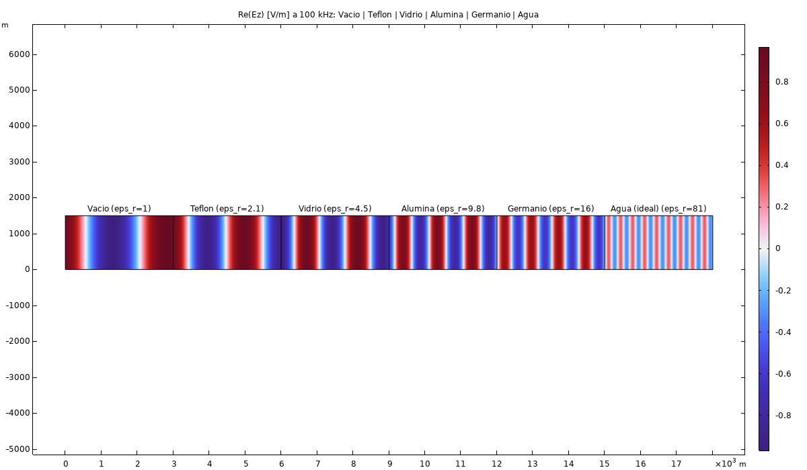
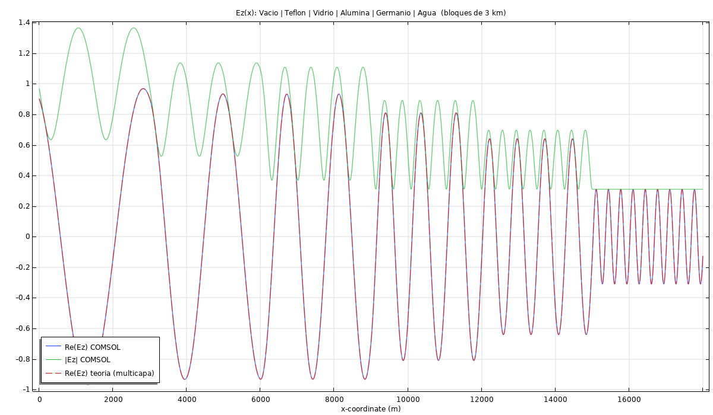

# Chain of Media (Lossless)

A single wave traveling through a sequence of five real lossless dielectrics in a row — vacuum → Teflon → glass → alumina → germanium → water — tracking how wavelength and phase velocity change at every interface, and what fraction of the original power makes it all the way through.

  
  

*Field distribution through the full vacuum→Teflon→glass→alumina→germanium→water chain. Each visible wavelength change in the line plot marks a new interface.*

## What it found

Overall, end-to-end through the chain:

| Quantity | Theory | COMSOL |
|---|---|---|
| \|S11\| | 0.3662 | 0.3663 |
| \|S21\| | — | 0.9305 |
| \|S11\|² + \|S21\|² | — | 1.000000 (energy conserved, as expected for a lossless chain) |

**13.41% of the incident power reflects back to the vacuum side; 86.59% makes it through to the water at the far end.** Maximum relative field error against the exact multi-interface solution: 4.0×10⁻⁵ — the numerical solve essentially reproduces the closed-form transmission-line-style result for a cascade of dielectric slabs. Full per-interface numbers in [`resultados.csv`](resultados.csv) and [`resumen_parametros_S.txt`](resumen_parametros_S.txt).
