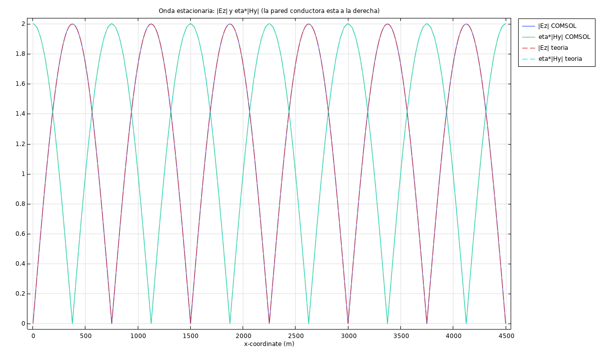
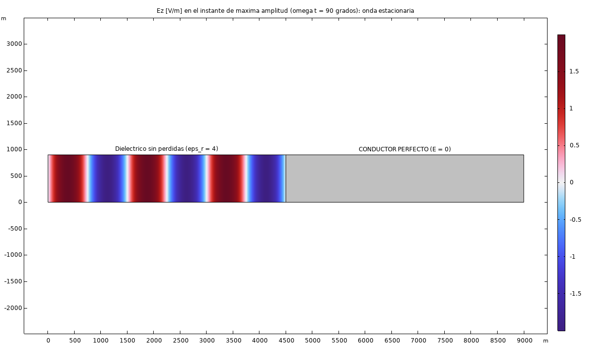

# Total Reflection Off a Perfect Conductor

A wave in a dielectric incident on a perfect-electric-conductor (PEC) wall — total reflection, and the standing wave it creates — checked node-by-node against theory.

  
  

*E and H field envelopes — the classic standing-wave pattern, with E nulls exactly where H peaks (and vice versa), spaced λ/2 apart.*

## What it found

| Quantity | Theory | COMSOL |
|---|---|---|
| λ in the dielectric | 1499 m | 1499 m (confirmed via 2× node spacing) |
| Phase velocity | 1.499e8 m/s | 1.499e8 m/s |
| \|Γ\| = \|S11\| | 1 | 1.000000 |
| Power transmitted into the conductor | 0% | 2.0×10⁻¹³ % (numerically zero) |
| ROE | infinite | infinite |
| \|E\| maximum | 2 V/m | 2.00000 V/m |
| \|E\| at the wall | 0 | 0.0 |
| E-field nodes (distance from wall) | 0, 749, 1499, 2248, 2998, 3747 m | matches, to the same precision |

**Total reflection confirmed to numerical-precision (10⁻¹³-level leakage, not exactly zero only because it's a finite-element solve, not a true boundary condition).** The standing wave's E-field nodes and H-field antinodes land exactly where theory predicts (every λ/2), with relative error against theory of 3.9×10⁻⁵ (E) and 2.1×10⁻³ (H) — see [`resultados.csv`](resultados.csv) for the full table.
