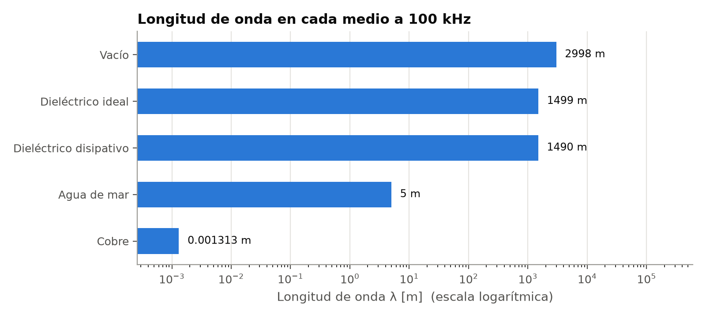
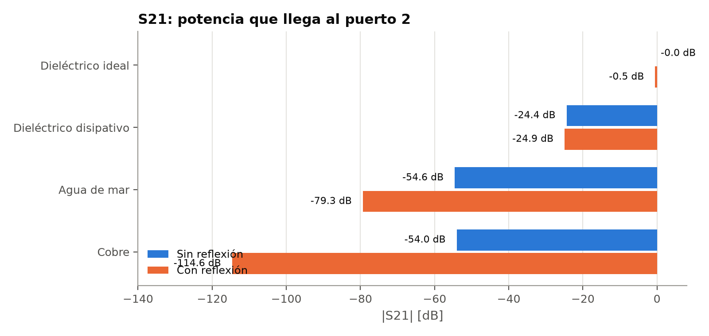

# Waves in Different Media and Reflection (Unit 10)

Four related COMSOL studies on electromagnetic wave propagation and reflection across different materials — vacuum, lossless and lossy dielectrics, seawater, and copper — building from simple propagation up to full reflection behavior.

  
  

*Wavelength and S21 transmission compared across all 5 media — the same comparison that anchors sub-studies 01 and 02 below.*

| Sub-study | What it covers |
|---|---|
| [`01-propagation-5-media/`](01-propagation-5-media/) | Propagation through vacuum, a lossless dielectric, a lossy dielectric, seawater, and copper — no reflection, just how λ, v, and attenuation change with the medium |
| [`02-reflection-vacuum-to-medium/`](02-reflection-vacuum-to-medium/) | A wave hitting a vacuum→medium boundary — reflection coefficient Γ, transmission τ, and standing-wave ratio for each of the same 4 non-vacuum media |
| [`03-chain-of-media/`](03-chain-of-media/) | A single wave traveling through a chain of 5 real dielectrics in sequence (vacuum → Teflon → glass → alumina → germanium → water), tracking how λ and v evolve at each interface |
| [`04-total-reflection-perfect-conductor/`](04-total-reflection-perfect-conductor/) | A dielectric-to-perfect-conductor boundary — total reflection and the resulting standing wave, with node/antinode positions checked against theory |

All four are cross-checked against closed-form theory (reflection/transmission coefficients, standing-wave ratio, node spacing) — every comparison in these sub-studies came back matching theory to within numerical-solver precision, not just "in the right ballpark."
