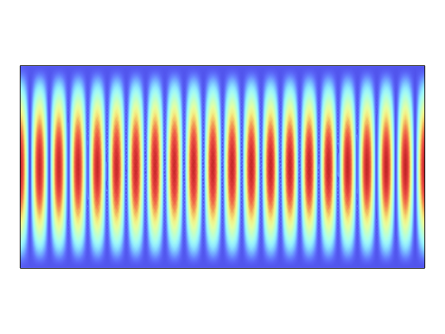
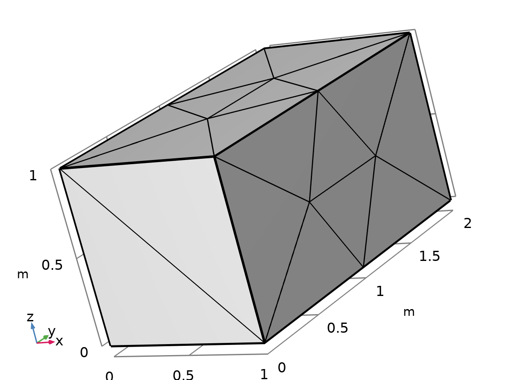
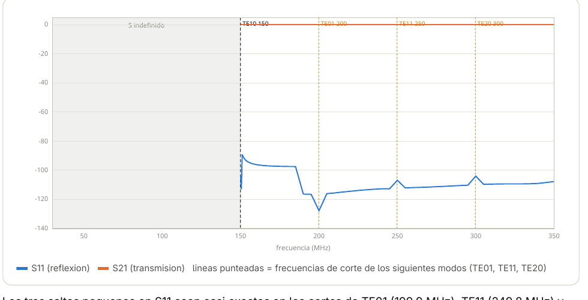
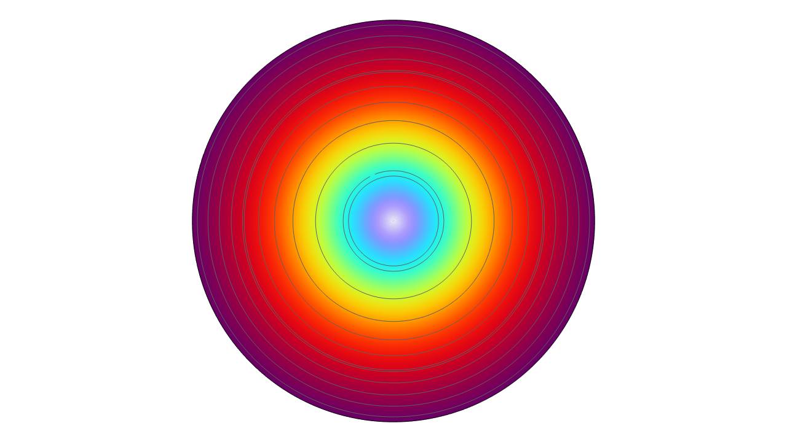
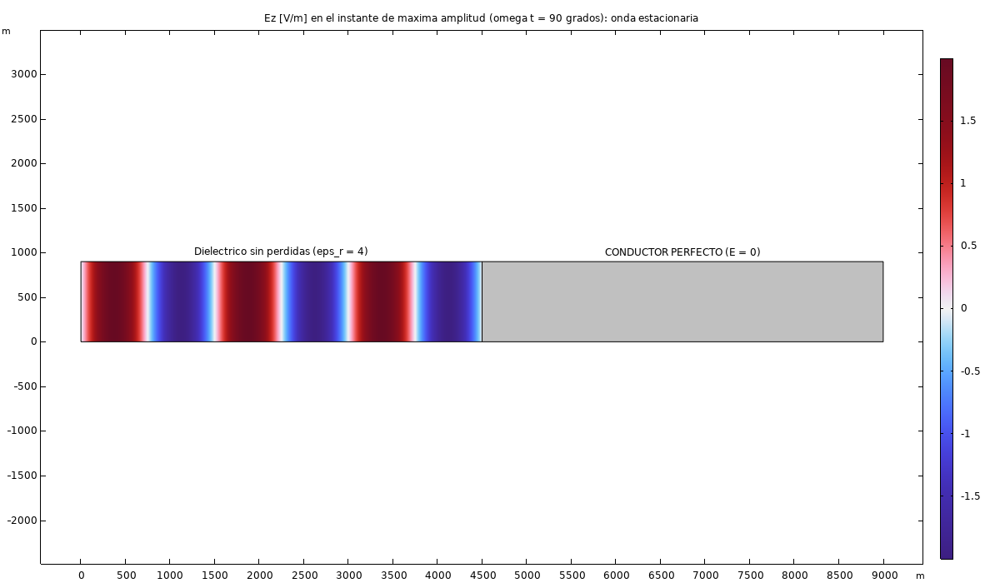

# Electromagnetics / RF Coursework

COMSOL RF Module coursework — plane waves, resonant cavities, waveguide ports, eddy currents, and wave propagation/reflection through different media. All 2D/3D *Electromagnetic Waves, Frequency Domain* (or *Magnetic Fields*) studies, no `.mph` model files here (see each project's own repo note or the original coursework folder for those) — figures, result tables, and the methodology, documented per topic.

| | Topic | What it covers |
|---|---|---|
|  | [`01-plane-wave-material-sweep/`](01-plane-wave-material-sweep/) | 2D plane wave at 1 GHz, swept across 27 combinations of εr, μr, σ — how each parameter changes wavelength and attenuation |
|  | [`02-resonant-cavity-modes/`](02-resonant-cavity-modes/) | Rectangular PEC cavity eigenfrequency solve, validated against the analytical TE/TM mode formula to within 0.005% average error across 19 modes |
|  | [`03-rectangular-waveguide-two-port/`](03-rectangular-waveguide-two-port/) | TE10 two-port S-parameter sweep (30–350 MHz) through a rectangular waveguide — including why S-parameters are undefined below cutoff, confirmed with both analytic and numeric port types |
|  | [`04-skin-effect-copper-coil/`](04-skin-effect-copper-coil/) | AC current density in a copper coil cross-section — the transition from a spread-out low-frequency distribution to the classic skin-effect ring at the conductor's surface |
|  | [`05-waves-in-media-reflection/`](05-waves-in-media-reflection/) | Four related studies: propagation through 5 media with no reflection, vacuum→medium reflection, a lossless chain of 5 media, and total reflection off a perfect conductor |

## Source

Original coursework and `.mph` models organized in a local COMSOL projects folder, not a public repo — this directory pulls out the documented, figure-backed results.
