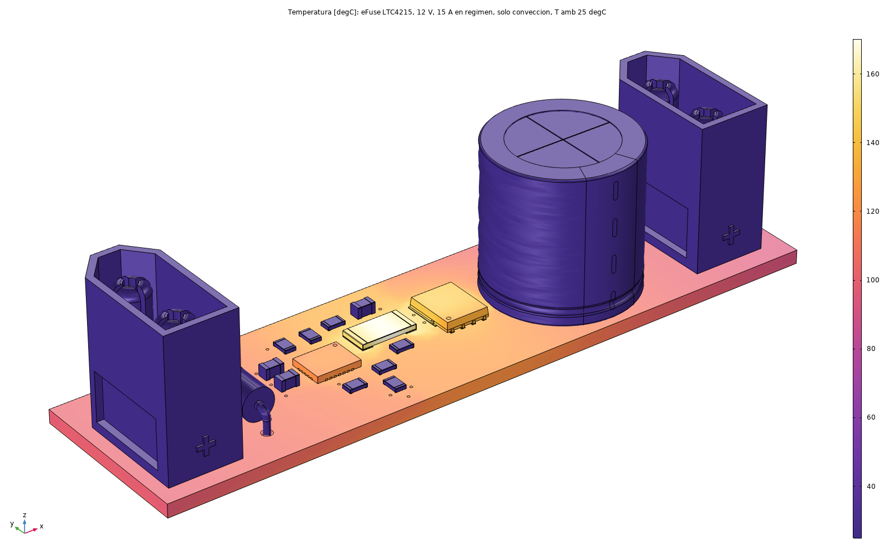
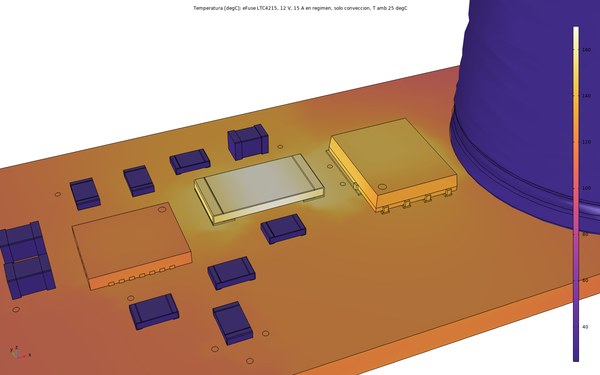
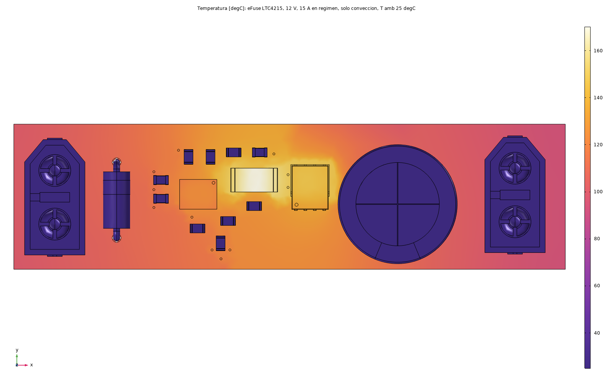
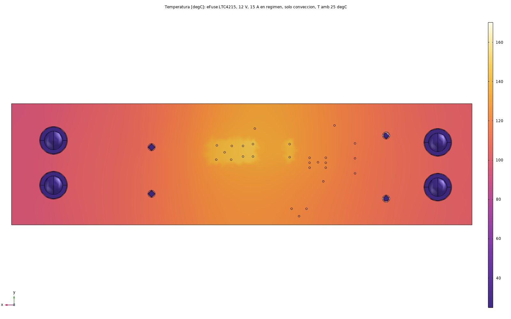
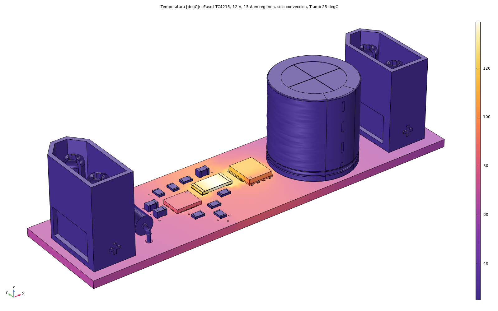

# EFUSE (LTC4215) Hot-Swap — Thermal FEM

Coupled **electrical-thermal** study of the LTC4215 hot-swap/eFuse board at its rated 12V/15A steady-state operating point — current flow through the copper pours is solved together with the heat, not neglected. Full project: [EFUSE-LTC4215-HotSwap](https://github.com/IKGB105/EFUSE-LTC4215-HotSwap).

  
  

*Left: full-board isometric thermal field at 15A. Right: close-up around R5 (current-sense resistor) and Q1 (MOSFET) — the two components the copper pours turned out to be competing with for "hottest part of the board."*

  
  
  

*Rightmost image: the same 15A case re-run with copper self-heating (I²R loss in the pours) switched off — the comparison that revealed how much of the heating the copper itself was responsible for.*

## Setup

- Software: COMSOL Multiphysics — an *Electric Currents, Shell* model (current through the copper) coupled both ways to a *Heat Transfer in Solids* model, natural convection, 25°C ambient, no heatsink.
- Geometry: PCB exported from the KiCad layout to STEP; vias read directly from the `.kicad_pcb` by a script ([`fem/codigo/termico_efuse.py`](https://github.com/IKGB105/EFUSE-LTC4215-HotSwap/blob/master/fem/codigo/termico_efuse.py) in the source repo), so the model regenerates if the board changes.
- Operating point: 12V input, 15A continuous (the controller's steady-state current limit, post-startup foldback).

## What it found

Unlike the LM317/LM2596 studies, this model solves the current flow through the copper pours together with the heat, instead of treating the copper as a passive conductor. That's what surfaced the main finding: **the copper pours themselves dissipate 1.6W — as much as every component on the board combined** — almost 2x what an earlier hand estimate (≈0.9W) gave for copper loss alone.

That copper self-heating pushes the sense resistor (R5), not the MOSFET, to the hottest point on the board: **170°C at 15A with convection only**, against Q1's junction at its 150°C rated limit. Thermal vias added under R5/Q1 (stitched to a dedicated SENSE− copper island, since they can't go straight to the ground pour without shorting) lower both by ≈10°C, but the bigger issue is the total heat on a small board, not just how it escapes those two components.

**15A continuous is not thermally safe in still air on this layout.** 12.5A continuous is the comfortable recommendation instead (128°C on R5 / 113°C on Q1). To reach 15A safely would need 2oz copper, wider/shorter pours, a higher-rated metal-strip R5, or forced airflow — documented as pending, not implemented, since this project was scoped as simulation + PCB layout only from the start.

## License

MIT — see the [source repo's license](https://github.com/IKGB105/EFUSE-LTC4215-HotSwap/blob/master/LICENSE).
