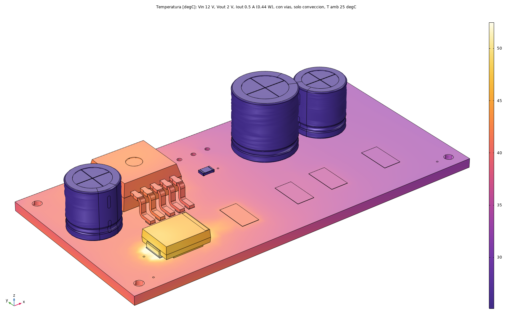
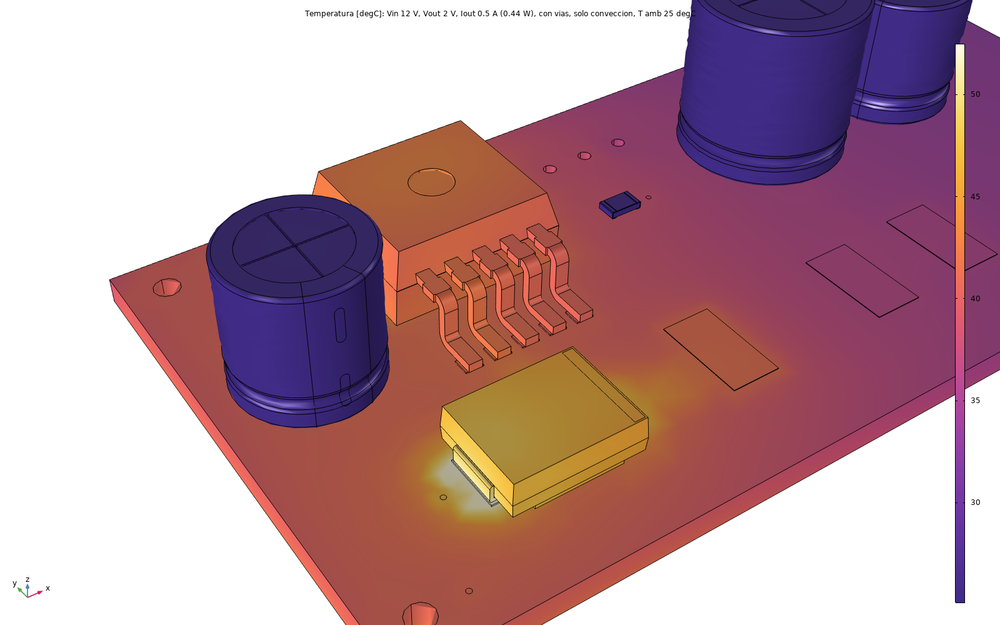
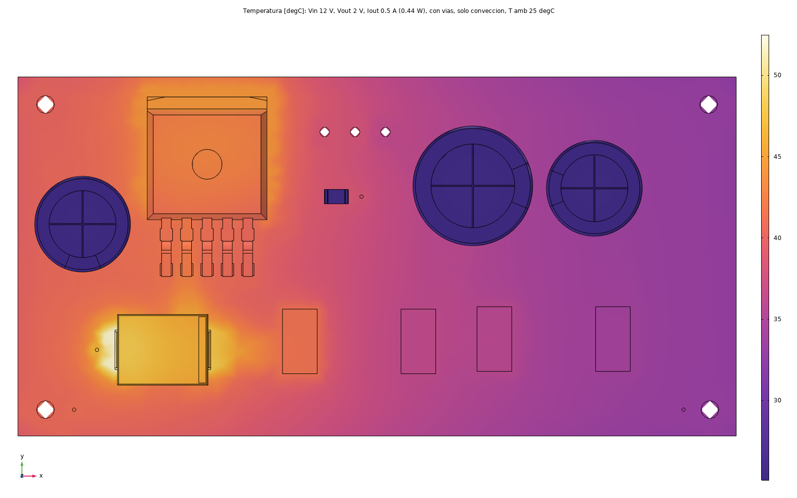
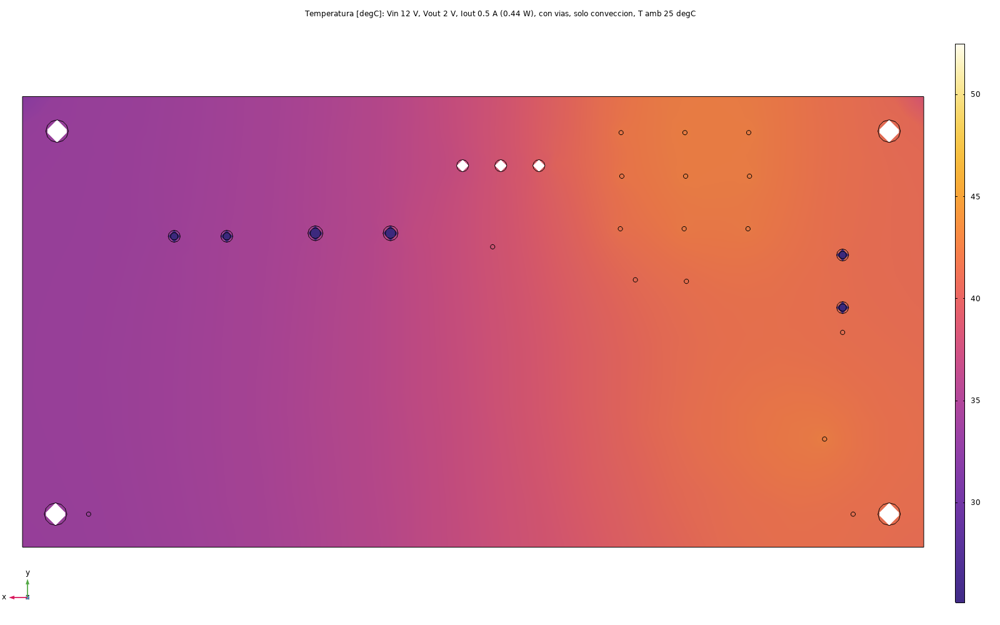
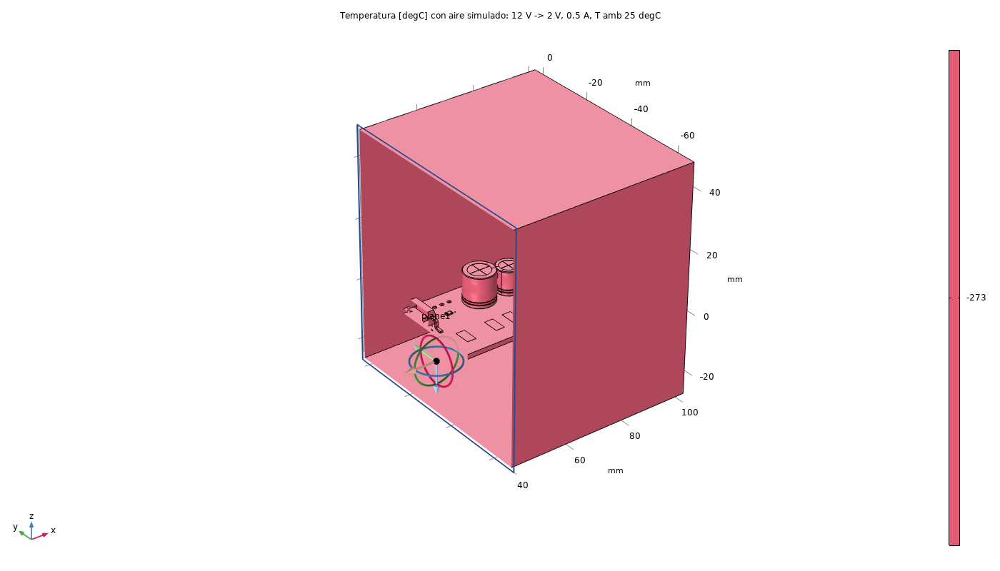

# LM2596 Buck Converter — Thermal FEM

Coupled thermal study of the adjustable LM2596 buck converter, at a demonstration condition (12V→2V @ 0.5A) and swept across the full adjustable range's worst case (35V→1.23V, 0.5–3A). Full project: [LM2596-Adjustable-Buck-Converter](https://github.com/IKGB105/LM2596-Adjustable-Buck-Converter).

  
  

*Left: full-board 3D thermal field at the demonstration condition. Right: close-up around U1 (regulator) and D1 (catch diode) — the two components actually being compared.*

  
  
  

## Setup

- Software: COMSOL Multiphysics, *Heat Transfer in Solids*, natural convection, 25°C ambient, no heatsink.
- Geometry: PCB exported from the KiCad layout to STEP.
- Heat sources: datasheet-derived analytical loss estimates (Vsat/Vf scaled from the LM2596's 3A datasheet values, assumed 100ns switching transition) — not measured or vendor-simulated.
- Two operating points solved: the 12V→2V/0.5A demo condition, and a current sweep (0.5–3A) at the range's worst-case 35V→1.23V ratio.

## What it found

**At the demonstration condition (12V→2V, 0.5A):** 0.444W total estimated loss, 44.3°C on the regulator's junction, 52.5°C peak on the catch diode — both comfortable, and a large improvement over the LM317 companion project's result at its own worst case (5.37W, ≈144°C with a heatsink).

**At the range's worst case (swept 0.5–3A at 35V→1.23V):** the catch diode D1 — not the LM2596 regulator IC itself — turned out to be the real thermal limit, exceeding its rated junction temperature above roughly 1.5–2A even though the regulator stays within limits through the full 3A sweep. Root-caused to a single isolated ground via at D1's anode pad, starving that corner of the board of copper to spread heat into. A fix (more copper/vias there) is proposed but not yet implemented in this revision.

## License

MIT — see the [source repo's license](https://github.com/IKGB105/LM2596-Adjustable-Buck-Converter/blob/master/LICENSE).
