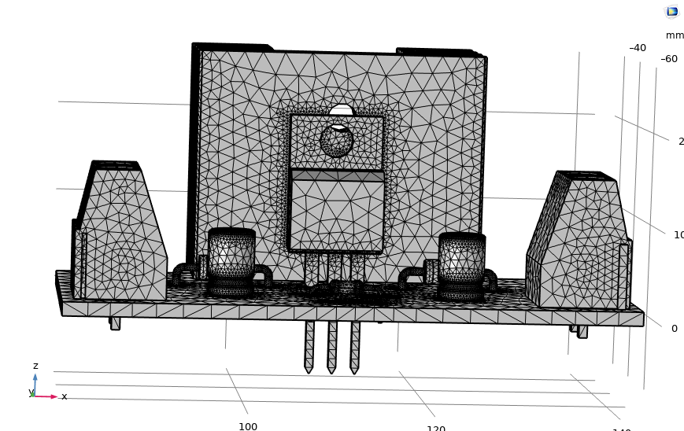
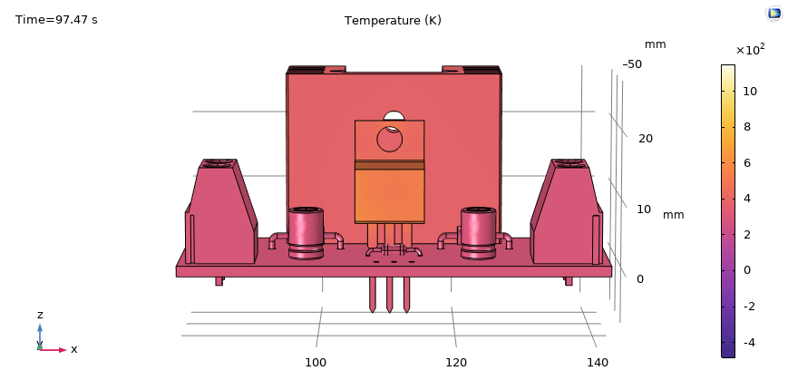

# LM317 Power Supply — Thermal FEM

Coupled thermal study of the adjustable LM317 power supply at its worst-case load (minimum V_out, I_max = 500 mA → P_d ≈ 5.37 W). Full project: [LM317-Adjustable-PowerSupply](https://github.com/IKGB105/LM317-Adjustable-PowerSupply).

  
  

*Left: the meshed geometry (PCB + AAVID 531202B00000G heatsink, imported from a STEP export of the KiCad board). Right: a late-stage snapshot of the thermal field — the attempted transient warm-up study itself was abandoned (solver instability from the natural-convection correlation's Rayleigh-number switch produced non-physical oscillating peaks); the reported result below is the separate, valid **stationary** solve.*

## Setup

- Software: COMSOL Multiphysics, *Heat Transfer in Solids*, natural convection, no forced airflow.
- Geometry: PCB + LM317 + heatsink exported from KiCad to STEP, imported directly (not redrawn).
- Heat source: P_d = 5.37 W at the LM317 die, from the worst-case analytical calculation.
- Material assumptions: LM317 body modeled as EMC (epoxy mold compound); generic filler parts as ABS — literature-typical values, not datasheet or measured.

## What it found

Getting a working model took several real rounds of debugging: flattening the STEP's nested assembly structure, removing a defective component solid, building an explicit LM317-to-heatsink thermal contact pair, and fixing a heat-source unit mismatch — twice.

The single biggest correction: the LM317's **tab is a separate solid in the 3D model and conducts heat far better than the epoxy body** — a TO-220 copper leadframe conducts roughly 500x better than the molding compound it's often lumped in with. Modeling it correctly (instead of all-epoxy) dropped the stationary junction temperature estimate by **~57°C**, from a previous best estimate of 200.87°C down to:

**T_J ≈ 416.92 K ≈ 143.77 °C** at the worst-case 5.37 W, with an AAVID 531202B00000G heatsink (θ_SA = 7.5 °C/W, upgraded mid-project from an insufficient Stonecold HS-132).

That still exceeds the LM317's 125°C absolute maximum rating — by ~19°C, down from the ~79°C analytical-vs-FEM gap the epoxy-tab model had implied. A 10-point parametric sweep over the heat source (1.47–5.97 W) confirmed θ_JA is essentially constant (21.6–22.1°C/W, 2.4% spread) across the whole operating range, which let the 125°C violation be resolved as a **current-derating table** (down to ~319 mA at the absolute worst case, full 500 mA safe above ~5–6V output) instead of a hardware change.

## License

MIT — see the [source repo's license](https://github.com/IKGB105/LM317-Adjustable-PowerSupply/blob/main/LICENSE).
